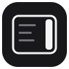
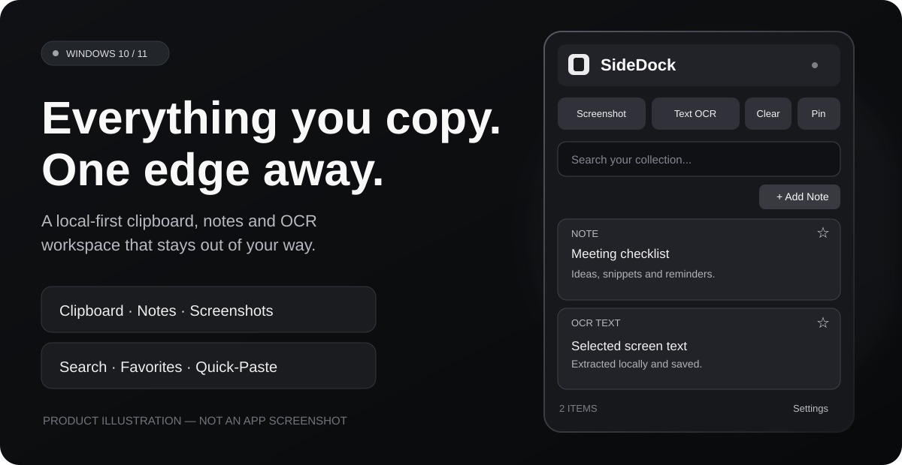
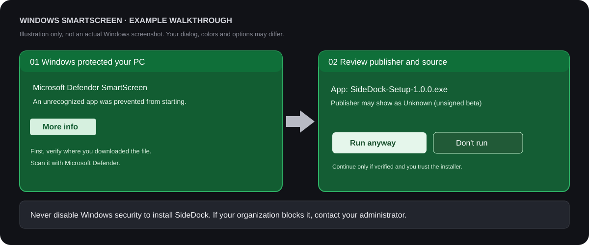

<p align="center">
  
</p>

<h1 align="center">SideDock</h1>

<p align="center"><strong>Everything you copy. One edge away.</strong></p>
<p align="center">A quiet, local-first workspace for clipboard history, screenshots, text extraction, notes, files and instant reuse on Windows.</p>

<p align="center">
  <a href="https://github.com/saileshchikkam/SideDock/actions/workflows/windows-build.yml"></a>
  <a href="LICENSE"></a>
  
  
  
</p>

<p align="center">
  <a href="https://github.com/saileshchikkam/SideDock/releases/download/v1.0.0/SideDock-Setup-1.0.0.exe">
    
  </a>
  <br>
  <sub>Free · Windows 10/11 · Direct .exe download · No GitHub account required</sub>
  <br>
  <sub>After download, open the installer and approve Windows security prompts to install.</sub>
</p>

<p align="center">
  <a href="#install-sidedock">Install SideDock</a> ·
  <a href="#features-at-a-glance">Explore features</a> ·
  <a href="#keyboard-shortcuts">Shortcuts</a> ·
  <a href="docs/INSTALLATION.md">Visual installation guide</a> ·
  <a href="https://github.com/saileshchikkam/SideDock/issues">Feedback &amp; issues</a>
</p>

> [!IMPORTANT]
> **SideDock v1.0.0 — public release.** Download the Windows installer directly from the [official GitHub Release](https://github.com/saileshchikkam/SideDock/releases/tag/v1.0.0); **no GitHub login or Actions ZIP is required**. The installer is **unsigned**, and Windows may show Microsoft Defender SmartScreen. Check the [safe installation instructions](docs/INSTALLATION.md) before running it.

<p align="center">
  
</p>
<p align="center"><sub>Product illustration based on the current feature set, not a captured screenshot. Real desktop screenshots will be added after release validation.</sub></p>

---

## Navigate

| Discover | Start using | Build & contribute |
| :--- | :--- | :--- |
| [Why SideDock?](#why-sidedock-exists) | [Windows installation](#install-sidedock) | [Run from source](#developer-quick-start) |
| [Feature tour](#features-at-a-glance) | [SmartScreen guide](#windows-smartscreen-what-to-expect) | [Tech stack](#how-its-built) |
| [Who is it for?](#who-its-for) | [Keyboard shortcuts](#keyboard-shortcuts) | [Build your own installer](#build-your-own-windows-release) |
| [How it fits your day](#a-better-everyday-workflow) | [Privacy & limits](#your-data-stays-on-your-pc) | [Security](SECURITY.md) · [License](LICENSE) |

## Why SideDock exists

Think about the number of times you **copy something, switch apps, find it again, open File Explorer, take a screenshot or retype a note** in a single day.

Windows already offers a clipboard, File Explorer and Snipping Tool. SideDock **doesn't replace Windows**. It brings the small pieces of work you repeatedly move between applications into **one reachable panel at the edge of your screen**.

**Less searching. Less switching. Less retyping. More momentum.**

| The usual workflow | With SideDock |
| --- | --- |
| Copy a code snippet, then lose it under the next copy | Keep recent snippets in searchable cards and favorite important ones |
| Switch back and forth to move several copied items | Open Quick-Paste and reuse the recent slots |
| Type a short reminder into a separate note app | Add and save a note directly inside the dock |
| Screenshot some text, then retype it manually | Select a screen region and extract editable text locally |
| Dig through folders to attach the same file again | Keep a saved file card and drag it to a compatible destination |
| Leave a big clipboard manager window open | Let the dock auto-hide to a slim screen-edge strip |

## Features at a glance

| Feature | What it does |
| --- | --- |
| **Auto-hiding edge dock** | Hides along the left or right screen edge, expands on hover, and can be pinned open. Supports dragging and resizing. |
| **Universal clipboard capture** | Records supported text, URLs, screenshots, images and copied files/folders into cards. |
| **One-click reuse** | Click a card to copy or paste into your active application when Windows focus rules permit; drag cards to compatible apps. |
| **Quick-Paste** | A shortcut opens a small popup for recent clipboard entries, including up to three numbered slots and an eight-second countdown. |
| **Local text OCR** | Select a screenshot region or use a clipboard/saved image; recognize English text on your PC and review it in the in-dock editor. |
| **Notes inside SideDock** | Press **+ Add Note**, write inside the dock, save as a card, and search, favorite or reuse it. |
| **Search & favorites** | Find past items and star the ones you want to keep when clearing ordinary history. |
| **Screenshot capture** | Launch Windows screen snipping from the **Screenshot** toolbar action; saved screenshots can appear in SideDock. |
| **Dark / Deep Dark / Windows themes** | Switch between restrained color palettes with increased legibility in dark modes. |
| **Drag-and-drop both ways** | Move files, images and text into SideDock and drag saved cards out to compatible targets. |
| **Notification-area controls** | Pause clipboard capture, select shortcut presets, change Start with Windows, and quit. |
| **Local storage tools** | Inspect stored usage, open your data folder and manually clean unused managed copies after confirmation. |

<details>
<summary><strong>How does screen-text extraction work?</strong></summary>

1. Select **Text OCR** in the dock.
2. Choose **Select Screen Region**, **Use Clipboard Image** or **Use Latest Saved Image**.
3. Drag over the text you want in SideDock's own pixel-aligned screen selector.
4. The bundled offline **Tesseract OCR** engine reads the image; the result opens **inside SideDock** for correction.
5. Save the text as a searchable card. The image and recognized text are **not uploaded**.

The **Screenshot** action is different: it launches Windows screen snipping. OCR accuracy varies with image sharpness, font, contrast and language. The bundled model targets **English**.

</details>

<details>
<summary><strong>What does Quick-Paste do?</strong></summary>

Continue copying several items. Open the Quick-Paste popup with its keyboard shortcut, then choose a visible slot. Standard Ctrl+V still works; SideDock may offer remaining recent items. Hotkey behavior depends on Windows foreground focus and whether global shortcuts are enabled.

</details>

## Who it's for

| Developers & engineers | Students, researchers & designers | Everyday Windows users |
| --- | --- | --- |
| Keep error messages, commands, API responses, SQL and code snippets handy | Collect excerpts, screenshots, class notes and temporary references | Save links, addresses, reminders, snippets and frequently shared files |
| Move text between IDEs, terminals, browser tabs and documentation | Turn screenshots containing English text into editable notes | Reuse copied content without hunting for the original |
| Quickly paste recent items without opening a large separate workspace | Search the collection while writing reports or working across sources | Keep important items starred and out of the way until needed |

### A better everyday workflow

```text
Copy an item → SideDock captures it locally → Find, star or pin its card
                                  ↓
                    Click, drag or Quick-Paste to reuse it

Screenshot → Text OCR → Select exact region → Review text in SideDock → Save
Idea or reminder → + Add Note → Write inside SideDock → Save a searchable card
```

SideDock works **alongside**, not instead of, standard Windows tools. Apps that restrict clipboard access or drag-and-drop behavior may have additional limitations.

## Install SideDock

### Option A — Windows installer (recommended)

**All most people need:** Windows 10 or 11 (64-bit). **No Python, pip, Git, coding tools, GitHub account or separate OCR installation required.**

<p align="center">
  <a href="https://github.com/saileshchikkam/SideDock/releases/download/v1.0.0/SideDock-Setup-1.0.0.exe"></a>
</p>

1. **Click Install SideDock above.** Your browser downloads `SideDock-Setup-1.0.0.exe` directly from the [official GitHub v1.0.0 release](https://github.com/saileshchikkam/SideDock/releases/tag/v1.0.0); no ZIP extraction or GitHub sign-in.
2. **Scan and verify** the downloaded file. SHA-256: `25c9bf3d04d7dc72ff5a20a4a153b2cd8af4777c24fac93db6e334e0ef73119c` (see the [installation guide](docs/INSTALLATION.md)).
3. Open the downloaded `.exe` and follow the Windows installer. Windows will request your approval; downloading cannot automatically run an installer.
4. **Start SideDock when I sign in to Windows** is selected by default. You can uncheck this during setup or toggle it later from SideDock's tray menu.
5. Hover at the configured screen edge to open the dock.

**[Read the complete illustrated installation walkthrough →](docs/INSTALLATION.md)**

> The installer is currently **unsigned**. On some Windows PCs you may see a SmartScreen warning. Do not disable Windows security; verify where the installer came from and check its hash before deciding whether to trust it.

### Windows SmartScreen: what to expect

<p align="center"></p>
<p align="center"><sub>Illustrative guide, not an authentic screenshot. Windows dialogs vary by version and policy.</sub></p>

1. **Check the source.** Download only from the [official SideDock v1.0.0 release](https://github.com/saileshchikkam/SideDock/releases/tag/v1.0.0). Scan the installer with Microsoft Defender.
2. **Verify its SHA-256 fingerprint** against the value shown on the official release page:

   ```powershell
   Get-FileHash ".\SideDock-Setup-1.0.0.exe" -Algorithm SHA256
   ```

3. If you trust the verified file and Windows displays **More info**, selecting it can reveal the program and publisher details.
4. **Run anyway** may then be available on some PCs. Choose it only when you trust the installer. If security policy blocks it or Defender detects malware, do not force or disable the protection.

**[Windows security troubleshooting and full walkthrough →](docs/INSTALLATION.md)** · [Microsoft SmartScreen documentation](https://learn.microsoft.com/en-us/windows/apps/package-and-deploy/smartscreen-reputation)

### Option B — From source (developers)

**Prerequisites:** Windows 10/11; [Git](https://git-scm.com/downloads); [Python 3.10+](https://www.python.org/downloads/windows/) and pip. Python 3.12 is the version tested in Windows CI.

In **PowerShell**:

```powershell
git clone https://github.com/saileshchikkam/SideDock.git
cd SideDock
git switch main

py -3.12 -m venv .venv
.\.venv\Scripts\python.exe -m pip install --upgrade pip
.\.venv\Scripts\python.exe -m pip install -e .
.\.venv\Scripts\python.exe -m sidedock
```

The editable install brings in **PySide6** and **keyboard** via `pyproject.toml`. Replace `py -3.12` with your installed supported Python version if needed. In a **source-only** run, offline OCR may also need a local Tesseract executable and English recognition data; the Windows installer already bundles these.

For troubleshooting, startup options and complete build prerequisites, see [Installation](docs/INSTALLATION.md).

## Keyboard shortcuts

| Action | Classic (default) | Alternative |
| --- | --- | --- |
| Native paste; recent copied cards appear in a small 8-second popup when 2+ items exist, even after restarting | `Ctrl + V` | `Ctrl + V` |
| Open Quick-Paste | **`Ctrl + Shift + V`** | **`Ctrl + Alt + V`** |
| Select recent slot 1/2/3 when visible | `Ctrl + Alt + 1/2/3` | `Ctrl + Shift + Alt + 1/2/3` |

**Enable SideDock shortcuts** is ON by default in **Settings → Keyboard Shortcuts** and the tray menu. **Ctrl+Shift+V** (Classic) opens Quick-Paste directly. Ordinary **Ctrl+V** always pastes normally; when two or more copied items exist, it also offers the three most recent copied cards for eight seconds. These remain accessible after restarting SideDock and after repeated pastes. You may disable the SideDock shortcuts if they conflict with another app, without disabling Windows Ctrl+V. Numbered shortcuts only work while their popup slots are visible.

## Your data stays on your PC

SideDock is **local-first**: there is no account, remote clipboard database or OCR cloud upload in the application.

**Saved data folder:** `%USERPROFILE%\SideDockData`

| Safety behavior | Current implementation |
| --- | --- |
| Local-only history | Text cards, notes and stored copies are saved on your PC |
| Auto capture control | Pause/resume automatic clipboard monitoring in Settings or the tray |
| Bounded storage | Up to **500** history items, **256 KiB** per text entry, **50 MiB** per new file/image, **500 MiB** managed copies |
| Safer persistence | Atomic history writes; existing history is not silently evicted when full |
| Cleanup | Confirm before removing unused managed file copies; original source files are not deleted by Clear |
| Foreground paste | Attempts to preserve the intended target; may leave content copied rather than paste into the wrong window |
| Single instance | Uses a local lock to prevent multiple concurrent SideDock watchers |

> [!WARNING]
> **Clipboard history is not encrypted.** Apps that do not mark copied content as sensitive can still have it recorded. Avoid copying credentials, private tokens or confidential data while capture is active. Review [Security & privacy](SECURITY.md) before using SideDock with sensitive work.

Uninstalling SideDock intentionally **preserves** the SideDockData folder so your notes/history are not silently lost. Delete it separately only if you want to permanently clear saved local content.

## How it's built

SideDock is a **native Windows desktop application**, not a browser-based JAMstack website.

| Area | Technology |
| --- | --- |
| App and business logic | **Python 3.10+** |
| Desktop interface | **PySide6 (Qt for Python)** |
| Windows integration | Windows clipboard APIs, tray integration, foreground-window handling and per-user startup registration |
| Shortcuts | `keyboard` and Windows key hooks |
| Image-to-text | **Tesseract OCR**, bundled offline in Windows installer builds |
| App packaging | **PyInstaller** with an installed, fast-start `onedir` runtime |
| Installer | **Inno Setup 6**, per-user install and uninstall |
| Automated checks | **GitHub Actions**, Python unit tests and packaged Windows smoke tests |
| License | **MIT**, with separate third-party notices for bundled OCR components |

**AI-assisted development:** SideDock's creator credits **Gemini 4 Hydrogen** and **OpenAI GPT-6 (ChatGPT)** as development collaborators. The shipped app runs on Python/Qt and does **not** require either AI service to function. This is a software-development credit, **not** a claim that the Windows app uses JAMstack or a Hydrogen web framework.

### Build your own Windows release

Building an installer requires additional tools beyond the everyday installation: **Python 3.12, PyInstaller, Inno Setup 6, Tesseract OCR and its English trained data**.

```powershell
# After cloning the repository and creating the .venv shown above:
.\.venv\Scripts\python.exe -m pip install -e . -r requirements-build.txt
$env:SIDEDOCK_OCR_DIR = "C:\Program Files\Tesseract-OCR"
.\.venv\Scripts\python.exe -m unittest discover -s tests -v
.\.venv\Scripts\python.exe scripts/build_windows.py
.\.venv\Scripts\python.exe scripts/build_installer.py
```

Build output: `dist/SideDock-Setup-1.0.0.exe`, a fast-start installed app under `dist/SideDock/`, and `dist/SHA256SUMS.txt`. GitHub Actions uploads **one installer EXE per new build artifact**. The source build is not intended for macOS or Linux.

## FAQ

<details><summary><strong>Does SideDock replace the Windows clipboard?</strong></summary>

No. It extends your workflow with a searchable visual history, notes, OCR, favorites and reusable cards while preserving normal copy and paste.

</details>

<details><summary><strong>Does it run when Windows starts?</strong></summary>

Yes, if **Start with Windows** stays selected during installation. It registers for the signed-in user. Windows may stagger startup apps after login, so it may not appear immediately. Change this in the tray if you prefer manual startup.

</details>

<details><summary><strong>Why did Microsoft Defender SmartScreen warn me?</strong></summary>

The current installer is **unsigned** and may not have established publisher reputation. Verify the file's source and checksum, scan it, and follow your organization's security policy. Do not disable Defender or override malware detections. See the [visual installation guide](docs/INSTALLATION.md).

</details>

<details><summary><strong>Why is there a ZIP if I only want one EXE?</strong></summary>

Use the large **Install SideDock** button above or the [direct .exe download](https://github.com/saileshchikkam/SideDock/releases/download/v1.0.0/SideDock-Setup-1.0.0.exe). This downloads just the Windows installer—no Actions artifacts, ZIP extraction or GitHub login. Windows still requires you to run and approve the downloaded program.

</details>

<details><summary><strong>Can I use SideDock offline? Is my clipboard uploaded?</strong></summary>

Yes, core features including local OCR work offline. The application has no backend or account. Your clipboard content and OCR images are not uploaded by SideDock.

</details>

<details><summary><strong>Is SideDock available for macOS, Linux or Android?</strong></summary>

Not in this release. The app is designed for Windows 10/11 and uses Windows-specific APIs.

</details>

## Roadmap & release status

- **Implemented:** edge dock, capture and paste, favorites, Quick-Paste, embedded notes, in-app region OCR, dark themes, local storage tools, Windows installer and startup registration.
- **Published:** the public v1.0.0 GitHub Release includes a directly downloadable Windows installer with a verified SHA-256 checksum. Broader Windows 10/11 hardware testing and code signing remain future improvements.
- **Future possibilities (not shipped):** code signing, built-in update checks, more OCR languages and accessibility refinement.

Follow [the changelog](CHANGELOG.md), [release checklist](docs/RELEASE_CHECKLIST.md) and [open issues](https://github.com/saileshchikkam/SideDock/issues). Please avoid posting sensitive copied content or private screenshots in public issues.

## Maintainer & credits

Created and maintained by **[Sailesh Chikkam](https://github.com/saileshchikkam)**.

- **License:** [MIT](LICENSE).
- **Bundled OCR attribution:** [Third-party notices](THIRD_PARTY_NOTICES.md) · [Tesseract OCR](https://github.com/tesseract-ocr/tesseract).
- **Optional GitHub profile styling:** [GitSkins](https://www.gitskins.com/) — a separate third-party GitHub README/profile design resource, **not** a SideDock feature or dependency.
- **Source, feedback & collaboration:** [GitHub repository](https://github.com/saileshchikkam/SideDock) · [Issues](https://github.com/saileshchikkam/SideDock/issues) · [Pull requests](https://github.com/saileshchikkam/SideDock/pulls).

---

<p align="center"><strong>Keep your screen clear. Keep your workflow moving.</strong></p>
<p align="center"><a href="#sidedock">Back to top ↑</a></p>
