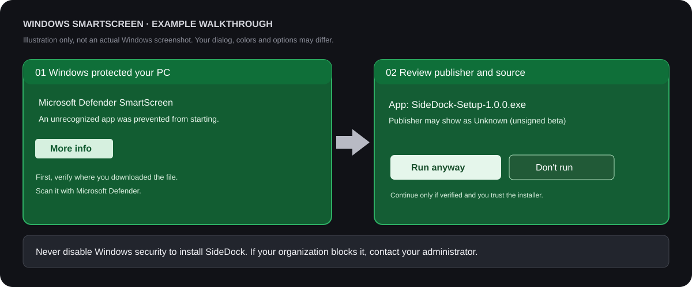

# Install SideDock on Windows

> [← Back to the project README](../README.md) · [Security](../SECURITY.md) · [Report a problem](https://github.com/saileshchikkam/SideDock/issues)

This guide is for the **unsigned v1.0.0 Windows installer**, distributed through GitHub Actions until a dedicated GitHub Release asset is published. Download only from this repository or a release page controlled by its maintainer. A Microsoft Defender warning can occur with an unsigned executable; this does not prove the file is safe or malicious.

## A. Recommended: installer (no Python required)

**Requirements:** Windows 10 or 11 (64-bit), permission to run programs for your own Windows user account, and enough free disk space for the installed Qt and offline OCR components. A GitHub account may be required to download GitHub Actions artifacts.

1. Open the [latest Windows build workflow](https://github.com/saileshchikkam/SideDock/actions/workflows/windows-build.yml). Choose a successful run on **`main`**.
2. Under **Artifacts**, download **SideDock-Windows-Installer**. GitHub Actions always wraps the artifact in a ZIP; it contains only `SideDock-Setup-1.0.0.exe`.
3. Extract that ZIP. Scan the setup file using **Windows Security / Microsoft Defender**.
4. Verify the installer checksum with PowerShell:

   ```powershell
   Get-FileHash ".\SideDock-Setup-1.0.0.exe" -Algorithm SHA256
   ```

   Compare the hash to the **installer SHA-256 shown in that exact GitHub Actions run's summary**. A matching hash shows that the file matches the published build; it is not a malware safety guarantee.
5. If you trust the verified build, open `SideDock-Setup-1.0.0.exe` and follow setup. **Start SideDock automatically when I sign in to Windows** is selected by default; you can opt out.
6. Start SideDock from the Start Menu (or the optional desktop shortcut). Hover near your chosen screen edge to reveal the dock.

No `pip`, Python, Tesseract installation, or administrator account is required for the installer. SideDock installs its Windows runtime and English OCR files together. It stores your notes and clipboard history in `%USERPROFILE%\SideDockData`.

## B. If Windows Defender SmartScreen warns you

The following visual is a **labeled illustration, not a screenshot of Windows**. Microsoft may show different colors, labels, or policy restrictions.



- **First:** confirm the file came from this repository's exact CI run, verify its hash, and scan it. Do **not** assume an unsigned app is safe simply because it is open source.
- On some Windows devices, the `Windows protected your PC` prompt includes **More info**. This can reveal the app and publisher details.
- **Only if you trust the verified file** and your PC permits it, you may choose **Run anyway**. If there is no such button, do not disable security protections; follow organizational policy or contact the administrator.
- A SmartScreen warning is not the same as a Defender malware detection. **Do not override a malware detection.**

Microsoft explains how unsigned app reputation works in its [SmartScreen developer documentation](https://learn.microsoft.com/en-us/windows/apps/package-and-deploy/smartscreen-reputation).

**Screenshot authenticity:** An earlier beta's real SmartScreen prompt has been recorded during testing. Two matching screenshots from the final installer (before and after selecting More info) still need to be captured and checked for personal information before adding to the public repository. We intentionally do not pass illustrated dialogs off as authentic Windows screenshots.

## C. Verify startup after installation

The installer offers **Start with Windows**, selected by default. SideDock registers startup for the current Windows user. Windows starts these apps *after sign-in*, sometimes after other startup applications; SideDock cannot guarantee an instant launch.

Use the **SideDock system tray menu → Start with Windows** to enable/disable it. If you previously used a portable version, quit the old SideDock and disable its old startup entry before switching to the installer. A single-instance lock prevents the same data store being opened by two instances.

## D. Install from Python source (developers)

For developers only; normal Windows users should use section A.

1. Install [Git](https://git-scm.com/downloads) and [Python 3.10+](https://www.python.org/downloads/windows/) with `py` available. Python 3.12 is used in the Windows CI.
2. In **PowerShell**:

   ```powershell
   git clone https://github.com/saileshchikkam/SideDock.git
   cd SideDock
   git switch main

   py -3.12 -m venv .venv
   .\.venv\Scripts\python.exe -m pip install --upgrade pip
   .\.venv\Scripts\python.exe -m pip install -e .
   .\.venv\Scripts\python.exe -m sidedock
   ```

   The `py -3.12` line assumes Python 3.12 is installed. If you have a different supported Python version, replace it with that version's `py -3.x` command.

This installs PySide6 and `keyboard` through `pyproject.toml`. For **source-only OCR**, you may need a locally installed Tesseract CLI with its English model; the release installer already bundles both.

## E. Build the Windows installer yourself (maintainers)

Requires Python 3.12, Git, **Inno Setup 6**, PyInstaller and Tesseract with `eng.traineddata`. The repository contains separate source build and package smoke checks.

```powershell
.\.venv\Scripts\python.exe -m pip install -e . -r requirements-build.txt
$env:SIDEDOCK_OCR_DIR = "C:\Program Files\Tesseract-OCR"
.\.venv\Scripts\python.exe -m unittest discover -s tests -v
.\.venv\Scripts\python.exe scripts/build_windows.py
.\.venv\Scripts\python.exe scripts/build_installer.py
```

The verified installer appears in `dist/SideDock-Setup-1.0.0.exe`. It contains the installed one-directory SideDock app, including the local OCR engine. Run the tests and inspect the corresponding SHA-256 checksum before redistributing.

## F. Troubleshooting

| Issue | What to check |
| --- | --- |
| No SideDock after installation | Check the system tray, hover near the selected screen edge, or start it once from the Start Menu. |
| SideDock starts late after reboot | Windows can stagger startup applications. Look for it after sign-in; this build avoids slow one-file extraction. |
| SmartScreen shows Unknown publisher | The current installer is unsigned. Verify the exact download and Defender scan; do not turn off security protection. |
| OCR finds no text | Select a readable region with sufficiently large text; try a clearer screenshot or a saved image. |
| Screenshot region seems offset | Use the latest successful main-branch installer, and report Windows display scaling and monitor arrangement in an issue. |
| A hotkey conflicts with another app | Change the shortcut preset or disable global shortcuts in Settings. |
| Installer ZIP contains multiple files | You have an older artifact. Choose **SideDock-Windows-Installer**, not **SideDock-Windows**. |
| A note or screenshot has sensitive information | Remove it from SideDock history. Local saved data is not encrypted. |

## G. Uninstall

Use **Windows Settings → Apps → Installed apps → SideDock → Uninstall** (labels vary by Windows version). The uninstaller removes application files and its own startup entry. **It preserves `%USERPROFILE%\SideDockData`** by design; make a backup or delete that folder separately only if you intend to remove local history and notes.

---

[Return to the README](../README.md) · [Privacy and security](../SECURITY.md) · [License](../LICENSE)
